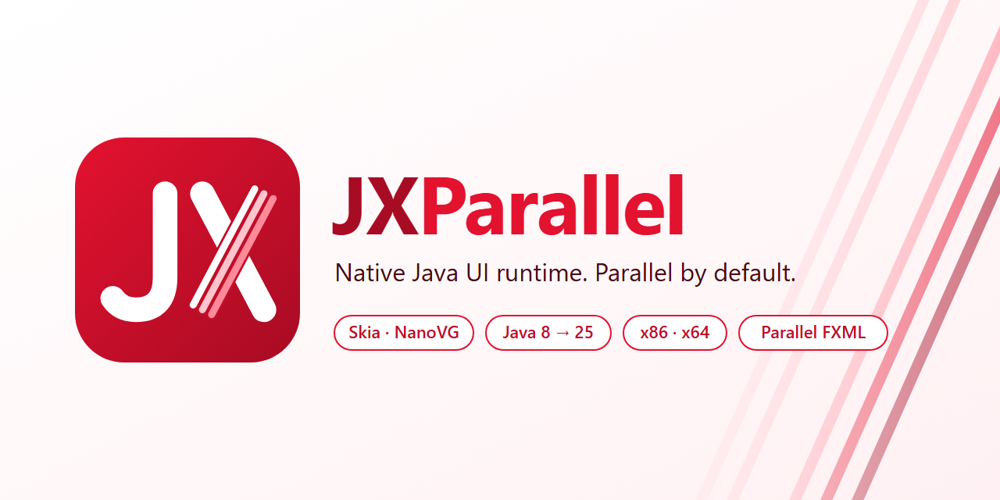
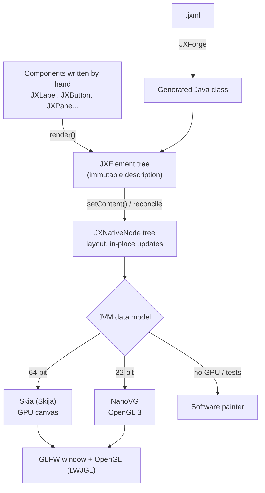
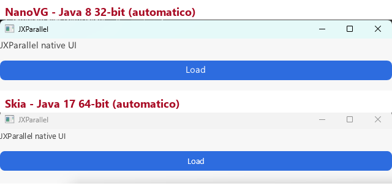
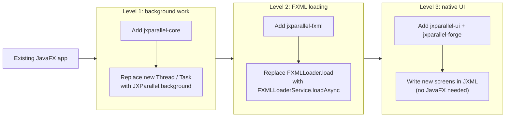

<p align="center">
  
</p>

<h3 align="center">Native Java UIs that start fast, stay small and never block on the UI thread.</h3>

<p align="center">
  Write screens as markup, compile them to plain Java at build time, draw them with Skia or NanoVG.<br>
  No JavaFX required. Runs on Java 8 to 25, 32-bit and 64-bit.
</p>

<p align="center">
  <a href="https://github.com/Bacuriim/JXParallel/actions/workflows/build.yml"></a>
  
  
  
  <a href="LICENSE"></a>
</p>

<p align="center">
  <a href="#quick-start">Quick start</a> ·
  <a href="#jxforge-screens-as-markup">JXForge</a> ·
  <a href="#the-widget-catalog">Widgets</a> ·
  <a href="#performance">Performance</a> ·
  <a href="#adopt-it-one-step-at-a-time">Adopt it gradually</a> ·
  <a href="#documentation">Docs</a>
</p>

---

## What it is

JXParallel is a Java UI runtime made of three parts that you can use together or one at a time:

| | | |
|---|---|---|
| **JXForge** | Screens written as markup (`.jxml`) with `${bindings}`, loops and conditions. A build step compiles them to plain Java: no XML parser and no reflection at runtime, and `javac` checks every controller call. | [Read more](#jxforge-screens-as-markup) |
| **Native UI** | A scene graph and 90+ widgets drawn straight to the GPU by Skia (64-bit) or NanoVG (32-bit). It does not depend on JavaFX. | [Read more](#native-ui) |
| **Parallel runtime** | A bounded, prioritized worker pool with backpressure, and an `FXMLLoader` that loads views in parallel while the UI keeps painting. | [Read more](#the-parallel-runtime) |

> **Status: pre-1.0.** The scheduler, properties, events, FXML loading, JXForge and the native
> widgets are tested and usable. The JavaFX-compatible API (`jxparallel-fx`) runs natively with
> `-Djx.backend=native` but has not been run on a large real application yet.
> See [project status](#project-status).

## Why you would use it

- **Fast to build and to show.** Compiled JXML builds a screen 19 to 20 times faster than the JavaFX
  controls do, and is ready to paint 86 times faster once warm (geometric mean of 43 components, Java 17).
- **Small.** About 47 times less memory retained per widget, half the classes loaded, 8 times less
  CPU over a run, in the same measurements.
- **Never frozen.** Heavy work and FXML loading run on a worker pool; the UI thread only paints.
- **Checked at build time.** A misspelled `${customer.nmae}` is a compile error that points at the
  `.jxml` line, not an exception on the user's machine.
- **Runs where JavaFX does not.** One build serves every JVM from 8 to 25, including 32-bit
  Windows, with the same shapes, colors and sizes on both renderers.
- **No big-bang rewrite.** Start by moving background work off the FX thread in your current JavaFX
  application; write new screens natively when you are ready.

## Quick start

Add JXForge and the native UI to a Maven project. JXParallel is not on Maven Central yet, so build
it once locally:

```powershell
git clone https://github.com/Bacuriim/JXParallel.git
cd JXParallel
mvn install -DskipTests
```

```xml
<dependencies>
  <dependency>
    <groupId>com.jxparallel</groupId>
    <artifactId>jxparallel-ui</artifactId>
    <version>0.1.0-SNAPSHOT</version>
  </dependency>
  <dependency>
    <groupId>com.jxparallel</groupId>
    <artifactId>jxparallel-forge</artifactId>
    <version>0.1.0-SNAPSHOT</version>
  </dependency>
</dependencies>

<build>
  <plugins>
    <plugin>
      <groupId>com.jxparallel</groupId>
      <artifactId>jxforge-maven-plugin</artifactId>
      <version>0.1.0-SNAPSHOT</version>
      <executions>
        <execution>
          <goals><goal>generate</goal></goals>
          <configuration><packageName>com.acme.views</packageName></configuration>
        </execution>
      </executions>
    </plugin>
  </plugins>
</build>
```

**1. Write the screen**, `src/main/jxml/hello.jxml`:

```xml
<Column controller="com.acme.HelloController" gap="12" padding="16">
  <Label text="${greeting}" fontSize="20" bold="true"/>
  <TextField text="@{name}" prompt="Your name"/>
  <Button text="Say hello" onAction="#sayHello"/>
</Column>
```

**2. Write the controller**, plain Java:

```java
public class HelloController {
    private String name = "";
    private String greeting = "Hello";

    public String getGreeting() { return greeting; }
    public String getName() { return name; }
    public void setName(String value) { name = value; }
    public void sayHello() { greeting = "Hello, " + name + "!"; }
}
```

**3. Open a window.** `mvn compile` generates `HelloView`:

```java
public class App {
    public static void main(String[] args) {
        HelloController controller = new HelloController();
        JXWindow window = new JXWindow("Hello");
        window.setContent(new HelloView().build(controller));
        window.show();
    }
}
```

That is the whole application. The window picks its renderer by itself (Skia on 64-bit JVMs, NanoVG
on 32-bit ones); `-Djx.renderer=skia|nanovg` forces one and `-Djx.monitor=N` opens it on another
monitor. During development `JxmlLiveView` watches the file and reloads the screen when you save
it, and keeps the last good version if the edit does not parse.

## JXForge: screens as markup

JXForge reads `.jxml` the way a protocol compiler reads a `.proto` file: once, at build time, and
the output is ordinary Java.

```text
.jxml ──(JXForge, at build time)──► Java class ──► JXElement tree ──► Skia / NanoVG / software
                                        ▲
                Java widgets written by hand go straight here
```

A larger screen:

```xml
<Border controller="com.acme.CustomersController">
  <Row slot="top" gap="4" padding="4 8">
    <Button text="Save" onAction="#save" defaultButton="true"/>
    <Button text="Delete" onAction="#delete" disabled="${readOnly}"/>
  </Row>
  <Tabs slot="center">
    <Tab title="Details" closable="false">
      <Grid hgap="8" vgap="6" padding="12">
        <Label text="Name" row="0" column="0"/>
        <TextField text="@{customer.name}" prompt="Full name" row="0" column="1" hgrow="always"/>
        <Label text="City" row="1" column="0"/>
        <ComboBox items="${cities}" value="${customer.city()}" row="1" column="1"/>
      </Grid>
    </Tab>
    <Tab title="Orders">
      <For items="${orders}" var="o" type="com.acme.Order" key="${o.id}">
        <ListTile title="${o.name}" onAction="#open(o)"/>
      </For>
    </Tab>
  </Tabs>
</Border>
```

| In the markup | What it does |
|---|---|
| `${customer.name}` | reads `controller.getCustomer().getName()` (`${a.b()}` for records) |
| `@{customer.name}` | two-way: reads it, and calls `setName(value)` when the user edits |
| `#save`, `#open(o)` | calls `controller.save()` / `controller.open(o)` with loop variables |
| `<For>`, `<If>` / `<Else>` | loops and conditions; their children are placed in the parent |
| `<For memo="true">` | keeps what a large loop built while its list is the same (trees of thousands of items) |
| `<Slot content="${x}"/>` | places a component or element you built in Java |
| `<Style>`, `style="..."`, `theme="dark"` | named styles with design tokens (`primary`, `surface`, `outline`, `error`...) and a dark theme |
| `<Include src="..."/>` | reusable screen parts |
| `Padding`, `Center`, `SizedBox`, `Card`, `ListTile`, `AppBar`, `Scaffold`... | composites that expand into primitives once |

The compiler and an interpreter that applies the same rules are tested against each other: both
must build the identical element tree for every screen, with constant-subtree hoisting on and off.
Use the interpreter for screens that only exist at runtime and the compiler for everything else.

Full reference: [docs/jxforge.md](docs/jxforge.md). Scope checklist:
[docs/jxforge-1.0.md](docs/jxforge-1.0.md).

## The widget catalog

JXForge 1.0 closes when essentially every widget used in JavaFX FXML, Flutter (Material) and Jetpack
Compose (Material 3) exists and is tested. 91 are done; JXML and JXForge use nothing of JavaFX, the
three catalogs only decide which widgets exist.

| | |
|---|---|
| **Layout** | `Column` `Row` `Stack` `Border` `Grid` `Flow` `Tile` `Anchor` `Pane` `Scroll` `SplitPane` `Scaffold` `SizedBox` `Spacer` `Expanded` `Flexible` `Padding` `Center` `Align` |
| **Text and input** | `Label` `TextFlow` `TextField` `PasswordField` `TextArea` `CheckBox` `RadioButton` `Switch` `ComboBox` `Spinner` `Slider` `DatePicker` `TimePicker` `ColorPicker` `Hyperlink` |
| **Buttons** | `Button` (filled, tonal, outlined, text, elevated) `IconButton` `Fab` `ToggleButton` `ButtonBar` `MenuButton` |
| **Collections** | `ListView` `TableView` `Tree` `TreeTable` (virtualized: only the window reaches the renderer) `Pagination` `Accordion` `TitledPane` `Tabs` `TabBar` `Stepper` |
| **Overlays** | `Dialog` `AlertDialog` `Modal` `Drawer` `SnackBar` `ContextMenu` `MenuBar` `Menu` `Tooltip` |
| **Display** | `Image` `Icon` `Avatar` `Badge` `Chip` `Separator` `ProgressBar` `ProgressIndicator` `Card` `ListTile` `AppBar` `NavigationBar` |

Out of scope for 1.0: animations and transitions, custom painters, WebView and OS dialogs.

## Native UI

`jxparallel-ui` is a scene graph with its own layout (preferred sizes, grow priorities, grids,
anchors, flow), controls with the Modena look and a Material look, focus, keyboard and pointer
routing, overlays and a software fallback.



An update builds the new element tree and reconciles it into the mounted nodes: nodes of the same
type are reused, only changed props are replaced, and a change stops climbing as soon as a node's
size comes out the same. Elements the renderer already holds are skipped, and nodes outside the
window are not painted.

Skija publishes no 32-bit native libraries, so 32-bit JVMs use NanoVG. Both renderers draw the
same shapes, colors and sizes:

<p align="center"></p>

Details: [docs/native-ui.md](docs/native-ui.md).

## Performance

Every component of the catalog was measured one by one against its JavaFX counterpart: 84
components, 4 modes (JavaFX controls, interpreted JXML, cached template, compiled JXML), 3 JVMs,
5 runs each in a fresh JVM, with a fingerprint that checks that every mode did the same work. Fixed
512 MB heap, Intel Core i5-12400F. The medians are in the repository.

<p align="center"></p>

Compiled JXML against the JavaFX controls, geometric mean over the 43 components that have a JavaFX
counterpart, Java 17:

| | JXML is |
|---|---:|
| Build the screen, cold / warm | **20x / 19x** faster |
| Native nodes ready to paint, cold / warm | **5.0x / 86x** faster |
| Change one prop of every instance | **4.9x** faster |
| Memory allocated: build / ready to paint / update | **20x / 107x / 2.7x** less |
| Memory retained per instance | **47x** less |
| Classes loaded | **2.1x** fewer |
| CPU of the whole process | **7.9x** less |

On Java 8 32-bit, building and getting ready to paint are 43x and 173x faster once warm.
JXML vs interpreting the file, on 20 form screens: compiled builds 30 to 40x faster warm.

### Where it is not ahead

Rebuilding an immutable element is not free, and this is measured, not hidden:

- **Tiny updates** (a `Slider` value, a `ScrollBar`, a `Separator`) cost more allocation than one
  JavaFX setter (0.08x to 0.5x). The model rebuilds and reconciles the element; the gap was
  narrowed, not removed.
- **Painting text fields and tabs** is behind JavaFX in the benchmark (0.6x to 0.8x), and the paint
  numbers are indicative: the software painter and JavaFX's Prism are different pipelines, and the
  GPU is not measured.
- **`Image`** allocates more than `ImageView` when it is created and updated.
- **JavaFX draws more** (CSS, skins, LCD text); part of every gap comes from that.

`Tree` and `TreeTable` updates used to be the worst case (every item was built on each update); with
`<For memo="true">` they now match JavaFX. What was behind and what changed:
[docs/jxforge-optimizations-2026-10-21.md](docs/jxforge-optimizations-2026-10-21.md).

Reports: [every component against JavaFX](docs/jxforge-components-benchmark-2026-10-21.md),
[20 form screens](docs/jxforge-benchmark-2026-10-21.md),
[UI stress, 32 and 64-bit](docs/ui-comparison-2026-09-25.md),
[FXML loading](docs/fxml-load-comparison.md).

<details>
<summary>UI stress and FXML loading tables</summary>

**UI stress: 4 components, 500 updates each, then 600 animated frames** (Windows 11, Core i7-1255U,
medians of 5 to 10 runs).

| Metric | JavaFX 8 x86 | JXParallel NanoVG x86 | JavaFX 21 x64 | JXParallel Skia x64 |
|---|---:|---:|---:|---:|
| JVM start to first frame | 855 ms | **761 ms** | 1568 ms | **888 ms** |
| Peak working set | 97.4 MB | **89.5 MB** | 249.9 MB | **154.2 MB** |
| Heap live after GC | 7.6 MB | **2.1 MB** | 10.6 MB | **2.1 MB** |
| CPU per frame | 4.1 ms | **1.4 ms** | 10.4 ms | **2.9 ms** |
| Allocation over 600 frames | 24.5 MB | **3.5 MB** | 34.1 MB | **4.8 MB** |
| Worst frame | 31.1 ms | **23.6 ms** | 56.9 ms | **13.1 ms** |

**FXML: 20 form screens with controllers.**

| Metric | JavaFX `FXMLLoader` | JXParallel `FXMLLoaderService` |
|---|---:|---:|
| 20 screens, cold JVM | 1467 ms | **538 ms** |
| 20 screens, warm | 692 ms | **31 ms** |
| One screen, warm | 40.7 ms | **7.8 ms** |
| Allocated per warm pass | 223.5 MB | **9.8 MB** |
| FX thread blocked (cold) | 1467 ms | **0 ms** |

Scheduler micro-benchmark: `ForkJoinPool` dispatches trivial tasks faster (29.7 ms against 57.1 ms
for 1,000 sequential tasks); the bounded pool trades microseconds for backpressure, priorities and
lower allocation.

</details>

## Adopt it one step at a time

You do not need to rewrite anything to start. Each level is independent and can stay in place for
as long as you need.



| Level | What changes in your code | JavaFX still required |
|---|---|---|
| 1. Background work | `JXParallel.start()` at startup, `shutdownNow()` at exit. Each `Task` plus `new Thread` becomes `JXParallel.background(...)` plus `JXParallelFx.ui(...)`. | Yes |
| 2. FXML loading | Each `FXMLLoader.load(url)` becomes `loader.loadAsync(path)`. FXML and controllers stay the same. | Yes |
| 3. Native UI | New screens are JXML (or `JXWindow` components). Existing JavaFX screens keep working. | No, for native screens |

## The parallel runtime

### Level 1: background work

<table>
<tr><th>JavaFX</th><th>JXParallel</th></tr>
<tr>
<td>

```java
Task<String> task = new Task<String>() {
    @Override
    protected String call() throws Exception {
        return service.greet(name);
    }
};
task.setOnSucceeded(e -> {
    status.setText(task.getValue());
    button.setDisable(false);
});
task.setOnFailed(e -> {
    status.setText("Unable to complete");
    button.setDisable(false);
});
Thread worker = new Thread(task);
worker.setDaemon(true);
worker.start();
```

</td>
<td>

```java
JXParallel.background(() -> service.greet(name))
    .thenAccept(value -> JXParallelFx.ui(() -> {
        status.setText(value);
        button.setDisable(false);
    }))
    .exceptionally(error -> {
        JXParallelFx.ui(() -> {
            status.setText("Unable to complete");
            button.setDisable(false);
        });
        return null;
    });
```

</td>
</tr>
</table>

```text
I/O, parsing, computation   ->  JXParallel.background(...)
Scene graph changes         ->  JXParallelFx.ui(...)   (Platform.runLater semantics)
```

Timeouts, priorities and cancellation when you need them:

```java
Task.of(() -> remoteService.fetch())
    .withTimeout(5, TimeUnit.SECONDS)
    .withPriority(TaskPriority.HIGH)
    .submit()
    .thenAccept(result -> JXParallelFx.ui(() -> render(result)));
```

The pool grows from `threads.min` to `threads.max` under load and lets idle workers expire. When
the queue is full, the configured policy decides whether the caller waits, fails fast or drops work,
so a burst of requests cannot exhaust memory.

### Level 2: parallel FXML loading

Same FXML files, same controllers. Only the loading call changes.

```java
FXMLLoaderService loader = new FXMLLoaderService();

// 1. The screen the user opened, alone: ready first
loader.loadAsync("/views/customers.fxml")
    .thenAccept(view -> JXParallelFx.ui(() -> tabs.getTabs().get(0).setContent(view)));

// 2. The others, in parallel, in the background
loader.loadAsync("/views/orders.fxml");
loader.loadAsync("/views/reports.fxml");
```

After the first load each file is kept as a pre-parsed template, so later loads skip XML parsing
and reflective lookups. On 20 form screens: one screen in 7.8 ms instead of 40.7 ms, all 20 in
31 ms instead of 692 ms (warm), with the FX thread blocked for 0 ms. `FXMLLoaderService` builds a
new `Parent` and controller on every load; views are never shared between scene graphs. `fx:include`,
`fx:define`, expressions, `%resources` and scripts fall back to `FXMLLoader`.

### Tests

```java
@ExtendWith(JXParallelJUnit5Extension.class)   // starts and stops the pool per test
class CustomerServiceTest { ... }
```

JUnit 4 (`JXParallelJUnit4Rule`), Mockito and PowerMock helpers are also available.

## Configuration

```java
JXParallel.applyConfiguration(JXParallelConfig.builder()
    .minThreads(2)
    .maxThreads(8)
    .autoScale(true)
    .queueCapacity(500)
    .queuePolicy(QueuePolicy.BLOCK)
    .build());
```

Or in `jx-parallel.config` next to the application:

```properties
threads.min=2
threads.max=8
threads.auto-scale=true
queue.capacity=500
queue.policy=BLOCK
fxml.cache.enabled=true
fxml.cache.strategy=LRU
```

Precedence, lowest to highest: built-in defaults, `jx-parallel.config`, environment variables,
Java system properties (`-Dthreads.max=12`), programmatic configuration.

| Queue policy | When the queue is full |
|---|---|
| `BLOCK` | the caller waits for a free slot |
| `REJECT` | the returned future fails with `RejectedExecutionException` |
| `DISCARD` | the new task is cancelled without running |
| `DISCARD_OLDEST` | the oldest queued task is cancelled to make room |

Full reference: [docs/configuration.md](docs/configuration.md).

## Platform support

| JVM | Architecture | Native UI renderer | Window opened and measured | CI (unit tests) |
|---|---|---|---|---|
| Java 8 | x86 | NanoVG | yes | Windows, core and UI |
| Java 8 | x64 | Skia | not yet | Ubuntu, core |
| Java 11 | x64 | Skia | not yet | Ubuntu |
| Java 17 | x64 | Skia | yes | Ubuntu, Windows |
| Java 17 | x86 | NanoVG | not yet | Windows |
| Java 21 | x64 | Skia | not yet | Ubuntu |
| Java 25 | x64 | Skia | not yet | Windows |

Everything compiles to Java 8 bytecode (`--release 8` on newer JDKs); the code JXForge generates is
Java 8 source. The newest Windows x86 JDK published by Temurin and Zulu is 17. The JavaFX modules
build against OpenJFX 21 and need JDK 17 or newer to compile. `jxparallel-ui` brings the LWJGL
natives for Windows x64/x86 and Linux x64, and Skija on 64-bit.

## Modules

| Module | Purpose | JavaFX |
|---|---|---|
| `jxparallel-core` | worker pool, tasks, configuration, properties, events, observable collections | no |
| `jxparallel-ui` | native scene graph, controls, layouts, `JXWindow`, Skia, NanoVG and software renderers | no |
| `jxparallel-forge`, `jxforge-maven-plugin` | JXForge: JXML compiler, interpreter, live view, Maven goal `jxforge:generate` | no |
| `jxparallel-javafx` | FX thread dispatch (`JXParallelFx`, `JXFxDispatcher`) and JavaFX control wrappers | yes |
| `jxparallel-fxml` | `FXMLLoaderService` with parallel loading and cache | yes |
| `jxparallel-fx` | JavaFX-compatible API that can run on the native renderer (`-Djx.backend=native`) | no |
| `jxparallel-junit4`, `-junit5`, `-mockito`, `-powermock` | test integrations | no |
| `jxparallel-benchmarks` | JMH and runtime comparison runners | no |
| `jxparallel-jcstress` | OpenJDK jcstress thread-safety tests (profile `jcstress`) | no |
| `jxparallel-examples-native` | native examples, the component benchmark and the UI stress runner | no |
| `jxparallel-examples` | JavaFX comparison apps and benchmarks | yes |

The default build has no JavaFX dependency:

```powershell
mvn test                      # core, UI, JXForge, test integrations, benchmarks
mvn -Plegacy-javafx test      # plus jxparallel-javafx, jxparallel-fxml, examples
mvn -Pcoverage test           # JaCoCo report in <module>/target/site/jacoco
```

The native UI tests run on JDK 17 (Skija does not run on a 64-bit Java 8). How the library itself is
tested (property-based, jcstress, golden images, pixel-for-pixel comparison of optimized paint paths,
JMH gate, ArchUnit, mutation testing): [docs/testing-strategy.md](docs/testing-strategy.md).

## Project status

| Area | Status |
|---|---|
| Worker pool, tasks, backpressure, lifecycle | Tested; used by all benchmarks |
| Properties, events, observable collections | Tested |
| FX thread dispatch and parallel FXML loading | Tested; pre-parsed templates with `FXMLLoader` fallback |
| Native window (Skia 64-bit, NanoVG 32-bit) | Working; Modena and Material looks |
| JXForge (JXML compiler, interpreter, Maven plugin, live view) | Implemented and tested; 91 widgets, loops, conditions, styles, themes, includes |
| Incremental UI updates | Implemented: memoized render and in-place reconciliation |
| Virtualized list, table, tree and tree table | Implemented |
| Overlays (dialogs, menus, pickers, snack bars) | Implemented; no keyboard navigation or hover inside popups yet |
| JavaFX-compatible API in native mode | Implemented and tested headless; not yet run on a large real application |
| CSS | Subset: selectors with specificity, pseudo-classes, looked-up colors, inline styles |
| Accessibility | Tree model only; no screen-reader adapter |
| FXML compiled by JXForge | Not yet; FXML is loaded by `FXMLLoaderService` |
| Gradle plugin for JXForge | Not yet; use the Maven plugin or the command line |

Roadmap: [docs/roadmap.md](docs/roadmap.md). Changes: [CHANGELOG.md](CHANGELOG.md).

## Documentation

| Topic | Document |
|---|---|
| Architecture and design rules | [ARCHITECTURE.md](ARCHITECTURE.md) |
| JXForge reference | [docs/jxforge.md](docs/jxforge.md) |
| JXForge 1.0 widget checklist | [docs/jxforge-1.0.md](docs/jxforge-1.0.md) |
| Every component against JavaFX | [docs/jxforge-components-benchmark-2026-10-21.md](docs/jxforge-components-benchmark-2026-10-21.md) |
| What was behind JavaFX, and what changed | [docs/jxforge-optimizations-2026-10-21.md](docs/jxforge-optimizations-2026-10-21.md) |
| 20 form screens: interpreted, cached, compiled | [docs/jxforge-benchmark-2026-10-21.md](docs/jxforge-benchmark-2026-10-21.md) |
| Native UI architecture | [docs/native-ui.md](docs/native-ui.md) |
| Configuration reference | [docs/configuration.md](docs/configuration.md) |
| Compatibility with JavaFX | [docs/compatibility.md](docs/compatibility.md) |
| UI comparison, 32-bit and 64-bit | [docs/ui-comparison-2026-09-25.md](docs/ui-comparison-2026-09-25.md) |
| Plain JavaFX vs JX on JavaFX vs JX native | [docs/fx-backends-comparison-2026-09-29.md](docs/fx-backends-comparison-2026-09-29.md) |
| FXML loading comparison | [docs/fxml-load-comparison.md](docs/fxml-load-comparison.md) |
| Testing strategy, compared with OpenJFX | [docs/testing-strategy.md](docs/testing-strategy.md) |

## FAQ

**Do I need JavaFX?** Not for JXForge and the native UI. Levels 1 and 2 of the adoption path improve
an existing JavaFX application, so they need it.

**Is `.jxml` a replacement for FXML?** It is a different language for the native renderer, with
widget-style tags (`Column`, `Button`...) rather than JavaFX class names. FXML files keep loading
through `FXMLLoaderService`.

**Can I mix JXML screens and widgets written in Java?** Yes. A `<Slot content="${x}"/>` places a
`JXElement` or component you built by hand, and a generated view is just a class that returns a
`JXElement`.

**Why compile at build time?** The generated class makes direct calls: no parsing, no reflection,
and `javac` checks the names. The interpreter exists for development and for screens that are only
known at runtime, and the tests keep both in agreement.

**Why is a tiny update slower than in JavaFX?** An update builds a new immutable element tree and
reconciles it, instead of setting one property in place. That costs a little for a single value and
pays back everywhere else; the measurements above show both sides.

**Which JVMs are supported?** Java 8 to 25, 32-bit and 64-bit. See [platform support](#platform-support).

## Contributing

Priorities, in order: compatibility, correctness, stability, performance. An optimization should
come with the behavior it preserves, a regression test, and a benchmark that states the workload and
runtime. See [CONTRIBUTING.md](CONTRIBUTING.md) and [SECURITY.md](SECURITY.md).

## License

[MIT](LICENSE)
