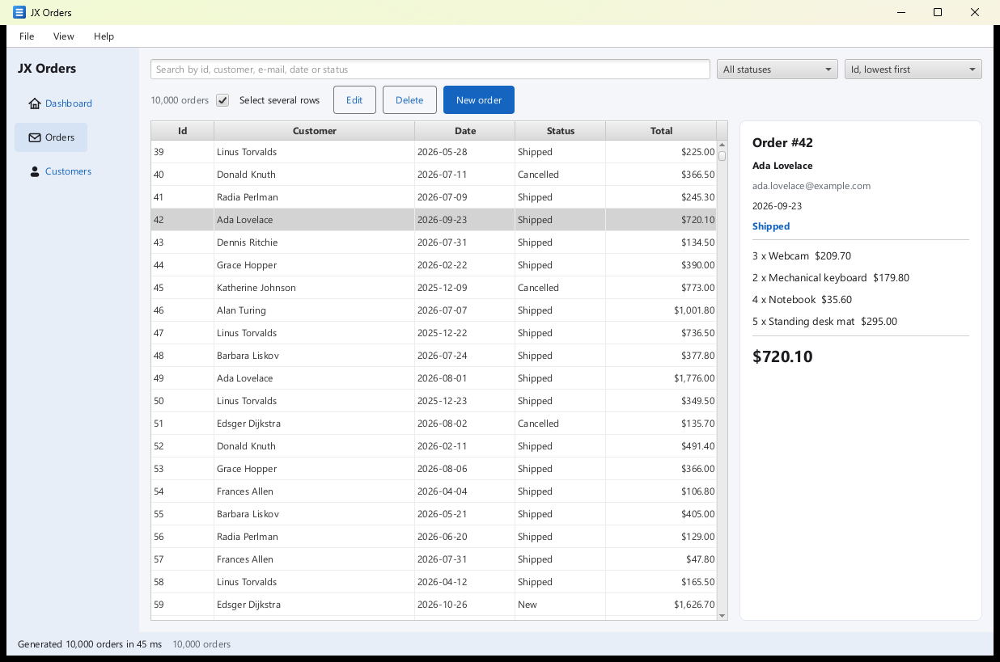
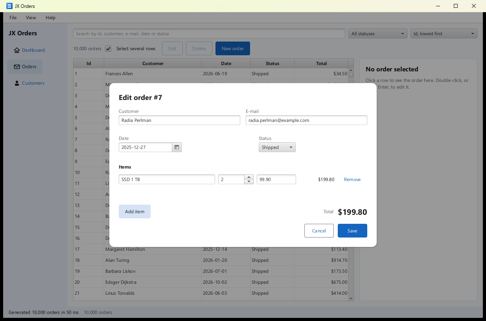
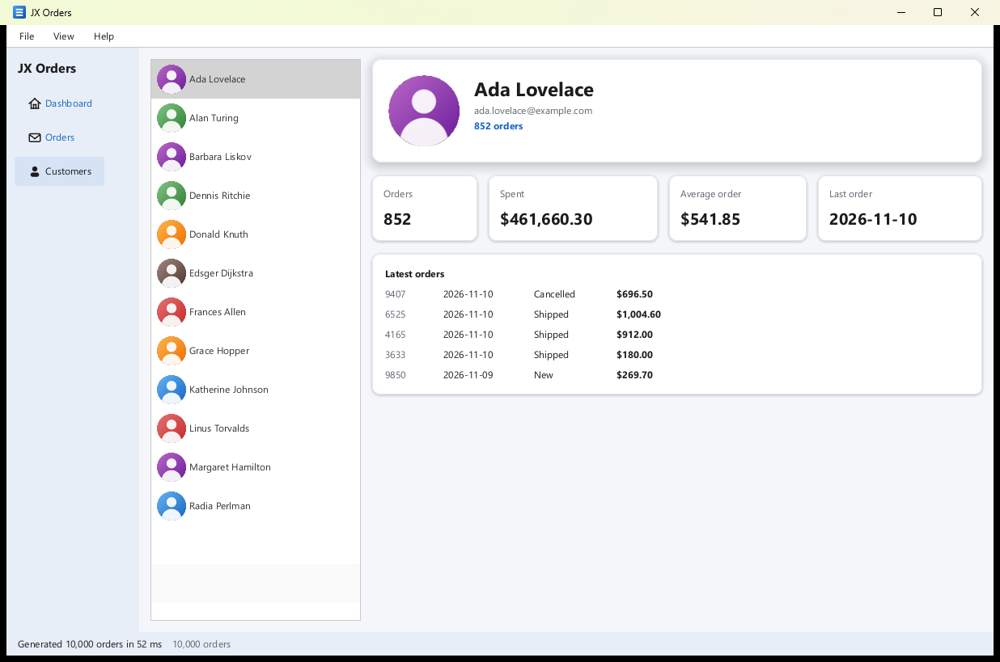
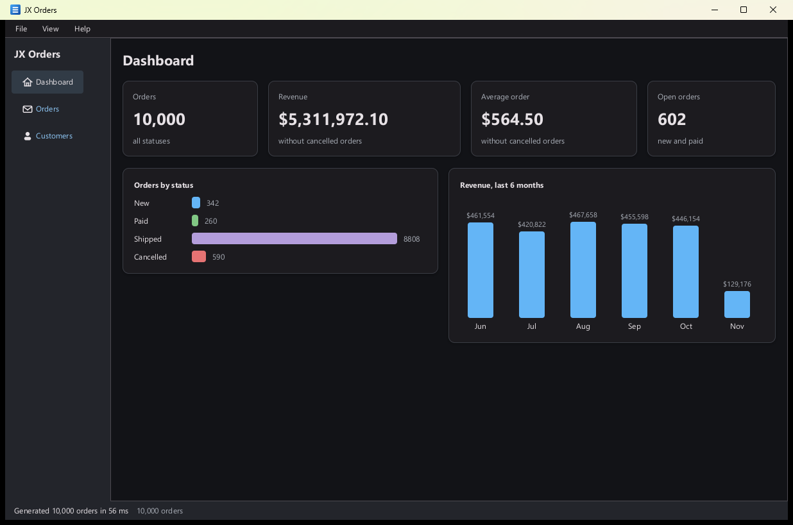

# JX Orders: a sample application

JX Orders is a small order-management desktop app, written to see whether the framework is usable for ordinary
application work and not only for component demos. It is in `jxparallel-examples-native`, package
`com.jxparallel.examples.orders`, with its screens in `src/main/jxml/orders/`. It uses no JavaFX: the screens are JXML
compiled to Java by JXForge, and the window is the native one (`JXWindow`).

| | |
|---|---|
|  |  |
| The orders screen: 10,000 orders in a virtual table, search, filters, a details panel | The order editor: validation, a date picker, a spinner, line items, a computed total |
|  |  |
| Customers: a list with pictures, a card with a shadow, figure cards that rise when clicked | The dashboard, in the dark theme: figures and bar visuals made of plain boxes |

The pictures were taken with the software renderer (`-Djx.renderer=software`) of the app started with the options
below, not from a mock-up.

## Run it

From the repository root, with JDK 8 or later and Maven on the `PATH`:

```
mvn -pl jxparallel-examples-native -am -Prun compile
mvn -pl jxparallel-examples-native -am -Prun "-Dapp.jvm=-Djx.renderer=software" "-Dapp.args=--screen=customers --theme=dark" compile
```

The `run` profile of `jxparallel-examples-native` builds the modules it needs (`-am`; nothing runs in them) and then
starts the program in its own JVM with the module's runtime classpath, so there is no `install` and no classpath to
build by hand (add `-o` to build offline). It stops when you close the window. `-Dapp=` picks the program
(`orders`, the default; `hello`, `metrics`, `stress`, `components`, `forge-load` are the other demos of this module),
`-Dapp.args=` gives it its arguments and `-Dapp.jvm=` the JVM's options. The goal is the phase `compile`, because the
profile binds the launch to it.

`scripts\run-orders.ps1` is the same command with shortcuts (`-Software`, `-Offline`, and the rest of the arguments go
to the app):

```powershell
scripts\run-orders.ps1                      # the app
scripts\run-orders.ps1 -Software            # the software renderer (-Djx.renderer=software)
scripts\run-orders.ps1 -Offline --screen=customers --theme=dark
```

Options of `OrdersApp` (they exist to show a screen without any input, for the pictures above and for trying it out):

| Option | Meaning |
|---|---|
| `--screen=orders` / `customers` / `dashboard` | the screen to open on (default `orders`) |
| `--orders=10000` | how many demo orders to generate |
| `--theme=light` / `dark` | the theme to start in (View menu changes it at run time) |
| `--select=42` | select that order once the orders are loaded |
| `--edit=7` | open that order in the editor once the orders are loaded |

## What it does

- **Menu bar.** File: New order (Ctrl+N), Open CSV..., Export CSV..., Exit. View: Light theme, Dark theme. Help: About
  (F1). A **sidebar** switches between Dashboard, Orders and Customers and a **status bar** shows the last message, a
  progress bar with a Cancel button while work runs, and the order count.
- **Orders.** A `TableView` over all the orders (10,000 generated at start; the table builds only the 40 rows around
  the viewport and scrolls over the whole list). The search box filters as you type (every word must appear in the id,
  customer, e-mail, date or status), a `ComboBox` keeps one status, another sorts. A check box switches between single
  and multiple selection (Ctrl+click adds a row, Shift+click a range, Shift+arrows extend, Ctrl+A selects all). The
  panel on the right shows the selected order with its lines, or the number and sum of several selected orders. Edit
  (also a double click or Enter on a row) and Delete (asks first) work on the selection.
- **Order editor** (a dialog). Customer, e-mail, date (`DatePicker`), status (`ComboBox`), line items (description, a
  `Spinner` for the quantity, unit price) that can be added and removed, and a total that follows every keystroke. A
  field shows its message once it was edited, or all of them when Save is pressed. Save is the default button (Enter),
  Ctrl+S also saves, Escape or Cancel closes without saving.
- **Customers.** A `ListView` whose rows have a picture (`Image src`, PNG files bundled in the jar), and for the selected
  customer a card with a shadow, four figure cards that rise when clicked (a `transition` on `translateY`) and the latest
  orders. The cards fade in when they first appear (`enter`).
- **Dashboard.** Four figures (orders, revenue, average order, open orders) and two bar visuals, orders by status
  and revenue of the last six months. There is no chart component, so the bars are boxes whose width or height is a number
  the controller computed.
- **Files.** Open CSV and Export CSV use the system dialogs (`JXFileDialogs`); a `.csv` file dropped anywhere on the window
  is imported (`onDrop`). The file has one row per line item (`id,customer,email,date,status,description,quantity,unit_price`),
  quoted as RFC 4180, so exporting and importing again gives the same orders. A row that cannot be read is skipped and
  counted in the status bar.
- **Theme, icon, tooltips, keyboard.** The theme changes at run time. The window has an icon in three sizes. Buttons and
  filters have tooltips. Tab goes through the controls in the order of the file (sidebar, search, filters, check box,
  buttons, table; inside the editor only the editor), the arrows move in the table, in lists and in open combo boxes, and
  F10 opens the menu bar.

## Where the work runs

Nothing slow runs on the UI thread. `Host` is the interface between the controllers and the program around them
(`WindowHost` in the real app, `TestHost` in the tests):

```text
UI thread (JXWindow's display thread)                    JXParallel worker pool
-------------------------------------                    ----------------------
menu / drop / button  -> ShellController.runWork  ---->  OrderGenerator.generate      (10,000 orders)
                                                          OrderCsv.read / write        (the file)
progress bar, status   <-- host.runOnUi(progress)  <----  progress after each chunk, cancel token polled
orders replaced, render <-- host.runOnUi(result)   <----  the finished list
file dialogs (blocking) ------------------------------->  host.chooseCsvToOpen / ToSave (a worker thread)
```

- `ShellController.runWork` submits the job with `JXParallel.background(Task...)` (`WindowHost.background`), with a
  `CancellationToken` that the Cancel button trips; the work polls it between chunks. One job runs at a time.
- The result comes back through `JXWindow.invokeLater` (`Host.runOnUi`), and only then are the orders replaced: the
  controllers and the `OrderStore` are touched by the UI thread alone. `Order` is immutable and the store's list is
  replaced, never changed in place, so a worker may read the list it was given while the UI goes on.
- `Host.requestRender` rebuilds the whole window (`shell.view()`, then `JXWindow.setContent`, which reconciles in place)
  and is coalesced: many changes before the next frame make one build.
- The blocking file dialogs run on a worker thread too, so the window keeps painting and answering while one is open.
- Filtering and sorting 10,000 orders on each keystroke takes a few milliseconds and runs on the UI thread; it is the one
  piece of work that is not moved off it, on purpose.

## How it is organised

```text
src/main/jxml/orders/           shell.jxml  orders.jxml  editor.jxml  customers.jxml  dashboard.jxml
src/main/resources/orders/      avatars/avatar1..8.png (96 x 96)   app-icon-32/64/128.png
src/main/java/.../orders/       controllers, model, Host, OrdersApp
  ShellController               the window: menu, sidebar, status bar, work on the pool, files
  OrdersController              search, filters, sort, window and selection of the table, details, delete
  EditorController              the dialog's state and its validation messages
  CustomersController, DashboardController
  Order, LineItem, Status, SortKey, OrderQuery, OrderDraft (validation), OrderCsv, OrderGenerator, OrderStore, ...
  Host, WindowHost, Session     the seam to the window and the thread pool; what the controllers of a window share
```

The build compiles `src/main/jxml/orders` to `com.jxparallel.examples.orders.gen` (`ShellView`, `OrdersView`, ...), by the
command line of JXForge in the default build and by `jxforge-maven-plugin` in the `jxforge-plugin` profile, as for the
other screens of the module (`jxparallel-examples-native/pom.xml`, execution `views-orders`).

The state is in plain controller classes read through bindings (`${visible}`, `@{query}`, `#editSelected`); there is no
singleton but `main`. The shell does not contain the other screens: `ShellController.getContent()` builds the current
one with its own view and controller, and `shell.jxml` places it with `<Slot content="${content}"/>`. `ShellController.view()`
is the whole window.

## Framework features used

| Feature | Where |
|---|---|
| Compiled JXML, bindings `${}`, two-way `@{}`, handlers `#m`, `<For>`, `<If>` / `<Else>` | all five screens |
| `TableView` with `first="@{top}"` over 10,000 items, `key`, `columns`, selection (`selected`, `selection`, `onSelect`, `onSelection`, `selectionMode`) | `orders.jxml` |
| `ListView` with a picture in each row, `selected="@{current}"` | `customers.jxml` |
| `MenuBar`, `Menu`, `MenuItem` with `accelerator` | `shell.jxml` |
| `Modal`, `AlertDialog`, `SnackBar` (overlays, `showing` / `onShowing`, `dismissible`), `defaultButton`, `accelerator` on a `Button` | `editor.jxml`, `shell.jxml`, `orders.jxml` |
| `TextField`, `ComboBox`, `DatePicker`, `Spinner`, `CheckBox`, `Button` variants | `orders.jxml`, `editor.jxml` |
| `Image src="classpath:..."`, `fitWidth` / `fitHeight` | `customers.jxml` |
| `elevation`, `transition`, `enter`, `translateY`, `cursor`, `tooltip` | `customers.jxml`, `dashboard.jxml`, `shell.jxml` |
| `onDrop` | `shell.jxml` |
| `ProgressBar`, `Icon`, `Card`, `SizedBox` | `shell.jxml`, `dashboard.jxml` |
| Theme: root `theme` prop plus palette bindings | `ShellController.view()`, `Palette` |
| `JXParallel.background` with `Task`, `CancellationToken`; `JXWindow.invokeLater`, `setIconFiles`, `setMinSize`; `JXFileDialogs` | `WindowHost`, `ShellController`, `OrdersApp` |

## What it works around

The app is honest about what the framework does not do yet. The list of what was met while writing it:

- (Fixed in JXForge since: these can now be bound, see `docs/jxforge.md`; the app was not rewritten.) `selectionMode`, `Button variant` and the root `theme` cannot be bound, so `orders.jxml` has one table for each selection
  mode in an `If` / `Else`, `shell.jxml` has a pair of buttons for each sidebar entry, and `ShellController.view()` sets the
  root's `theme` prop in Java after the compiled view built the tree.
- A theme token (`surface`, `onSurface`...) is resolved when the file is read, so the screens bind colours from `Palette`.
  `Scroll`, `ListView`, `TableView` and the classic controls (`TextField`, `ComboBox`, the text of a `CheckBox`) paint their
  light look whatever the theme, so the dark theme is complete only where the app uses its own boxes and the Material
  controls. The dashboard and the customer page are not in a `Scroll` for that reason.
- The table has no clickable column headers, so sorting is a combo box.
- A `Button` with an `Icon` child does not act when the icon is clicked unless the icon is `mouseTransparent`.
- There is no hover event, so the figure cards rise when clicked, not on hover.

## Tests

```powershell
mvn -o -q -pl jxparallel-examples-native -am test
```

| Test class | What it checks |
|---|---|
| `OrdersModelTest` | money, totals, search and sort, the generator, validation rules, the CSV round trip and bad rows, the store, the dashboard numbers |
| `OrdersControllersTest` | the controllers with the real worker pool: where work runs, progress, Cancel, one job at a time, files, the dialogs, drops, selection, delete, the editor, the theme |
| `OrdersScreensTest` | every screen mounted without a window in both themes, 10,000 rows in the table with a window of 40, the avatars, the dashboard bars, compiled views against the interpreter reading the same `.jxml` files |
| `OrdersGesturesTest` | typing in the search box, the filter lists, clicking, Ctrl+click, Shift+click, arrows, Home / End, Enter, Escape, Ctrl+N, Ctrl+S, F1, Tab order, the menu, the sidebar, the theme and a dropped file, through the same calls `JXWindow` makes for its input callbacks (`OrdersUi`, a copy of the harness of `JxmlComponentBehaviorTest`) |

## Not checked

The tests and the pictures cover the screens, the controllers and the input calls, not a person using the app: the system
file dialogs, the real drop of a file from the file manager, the keyboard and the mouse in a real window, and the frame pacing
of the animations were not exercised.
